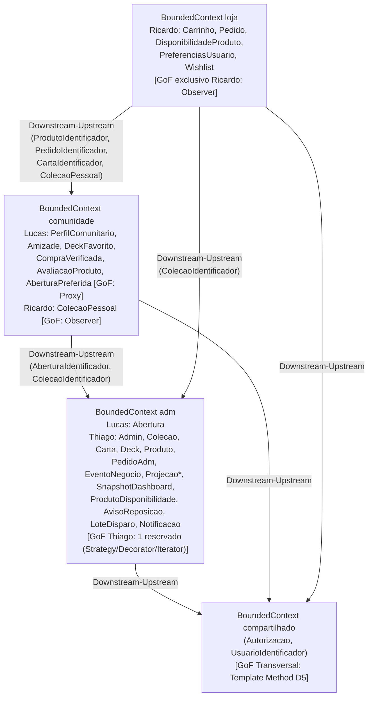

# Context Mapper e Arquitetura Unificada — TCGHub

Este documento consolida o modelo estratégico e tático unificado (**DDD Estratégico + Tático + Clean Architecture**) de **todos os integrantes do TCGHub** (**Lucas Menezes**, **Ricardo Freitas** e **Thiago Medeiros**) no padrão **D5**, em estrita conformidade com [.agents.md](../../.agents.md) e [tcghub/AGENTS.md](../../tcghub/AGENTS.md).

---

## 1. Modelos CML e DBML do Monorepo

| Artefato | Caminho | Escopo |
| :--- | :--- | :--- |
| **Raiz CML** | [tcghub/docs/projeto.cml](../../tcghub/docs/projeto.cml) | Importação global dos bounded contexts (`compartilhado`, `adm`, `comunidade`, `loja`) |
| **Compartilhado CML** | [tcghub/docs/compartilhado/projeto.cml](../../tcghub/docs/compartilhado/projeto.cml) | Domínio, subdomínios, `Autorizacao`, `UsuarioIdentificador` |
| **Administração CML** | [tcghub/docs/adm/projeto.cml](../../tcghub/docs/adm/projeto.cml) | **Lucas** (`Abertura`) + **Thiago** (`Admin`, `Colecao`, `Carta`, `Deck`, `Produto`, `PedidoAdm`, `EventoNegocio`, `ProjecaoPedido`, `ProjecaoProduto`, `ProjecaoColecao`, `SnapshotDashboard`, `ProdutoDisponibilidade`, `AvisoReposicao`, `LoteDisparo`, `Notificacao`) |
| **Comunidade CML** | [tcghub/docs/comunidade/projeto.cml](../../tcghub/docs/comunidade/projeto.cml) | **Lucas** (`PerfilComunitario`, `Amizade`, `DeckFavorito`, `CompraVerificada`, `AvaliacaoProduto`, `AberturaPreferida`) + **Ricardo** (`ColecaoPessoal`) |
| **Loja CML** | [tcghub/docs/loja/projeto.cml](../../tcghub/docs/loja/projeto.cml) | **Ricardo** (`Carrinho`, `Pedido`, `DisponibilidadeProduto`, `PreferenciasUsuario`, `Wishlist`) |
| **Banco DBML** | [tcghub/docs/adm/projeto.dbml](../../tcghub/docs/adm/projeto.dbml), [tcghub/docs/comunidade/projeto.dbml](../../tcghub/docs/comunidade/projeto.dbml), [tcghub/docs/projeto.dbml](../../tcghub/docs/projeto.dbml) | Esquema relacional da Onda 2 (Lucas: `ABR_`, `PCM_`, `PCF_`, `AMI_`, `DFA_`, `CVE_`, `AVA_`, `APR_`) |

---

## 2. Diagrama de Contextos Delimitados (Grafo Acíclico D5)

> [!IMPORTANT]
> - **Grafo estritamente acíclico**: `loja → comunidade → adm → compartilhado`. Nenhum subdomínio upstream importa ou depende de um downstream.
> - **Padrão D5 em 100% dos agregados**: cada `Aggregate` possui exatamente **uma única `Entity` `aggregateRoot`** com o mesmo nome do agregado e seu `Repository` declarado internamente com as operações D5 (`incluir`, `existePorIdentificador`, `buscarPorIdentificador`, `alterar`, `excluir`) além das consultas de negócio. Sub-entidades internas de modelos originais foram convertidas em `ValueObject`s imutáveis ou agregados independentes, com valores monetários em `BigDecimal`.
> - **Isolamento de banco**: referências inter-subdomínios ocorrem via objetos de valor de identidade e contratos/serviços de domínio (Proxies/SPIs para Lucas, Observers para Ricardo e contratos explícitos de sincronização/projeção para Thiago).

---

## 3. Mapa Completo de Agregados e Trava Rígida GoF

### 3.1 Lucas Menezes — GoF Exclusivo: **Proxy** *(ZERO `Observer`)*

| Subdomínio | Funcionalidade | Agregado (Entidade Raiz) | Identificador | Proxy Arquitetural / Papel |
| :--- | :--- | :--- | :--- | :--- |
| `adm` | [F001](../../tcghub/docs/adm/funcionalidades/F001.md) — Gestão de Aberturas | `Abertura` | `AberturaIdentificador` | Base de aberturas consumida por `AberturaPreferidaPrivacidadeProxy` |
| `comunidade` | [F001](../../tcghub/docs/comunidade/funcionalidades/F001.md) — Perfil e amigos | `PerfilComunitario` | `PerfilComunitarioIdentificador` | `PerfilComunitarioVisibilidadeProxy` (visibilidade pública vs. dono e bloqueio de mutação) |
| `comunidade` | [F001](../../tcghub/docs/comunidade/funcionalidades/F001.md) — Perfil e amigos | `Amizade` | `AmizadeIdentificador` | Solicitações, aceite, recusa, cancelamento e remoção bilateral |
| `comunidade` | [F002](../../tcghub/docs/comunidade/funcionalidades/F002.md) — Decks favoritos | `DeckFavorito` | `DeckFavoritoIdentificador` | `CatalogoDeckProxy` (integração ACL com Catálogo sem acesso ao banco externo) |
| `comunidade` | [F003](../../tcghub/docs/comunidade/funcionalidades/F003.md) — Avaliação de cartas | `AvaliacaoProduto`, `CompraVerificada` | `AvaliacaoProdutoIdentificador`, `CompraVerificadaIdentificador` | `AvaliacaoElegibilidadeProxy` (valida compra paga e não reembolsada antes da avaliação) |
| `comunidade` | [F004](../../tcghub/docs/comunidade/funcionalidades/F004.md) — Abertura preferida | `AberturaPreferida` | `AberturaPreferidaIdentificador` | `AberturaPreferidaPrivacidadeProxy` (oculta escolha no perfil/amigos mantendo cômputo anônimo no ranking Top 5) |

### 3.2 Ricardo Freitas — GoF Exclusivo: **Observer** *(BLOQUEADO para Lucas e Thiago)*

| Subdomínio | Funcionalidade | Agregado (Entidade Raiz) | Identificador | Observer Arquitetural / Papel |
| :--- | :--- | :--- | :--- | :--- |
| `loja` | Comprar produto | `Carrinho` | `CarrinhoIdentificador` | Gestão do carrinho sem reserva de estoque |
| `loja` | Comprar produto | `Pedido` | `PedidoIdentificador` | `PedidoEventoObserver` (publica criação, aprovação, cancelamento/expiração e reembolso para observadores) |
| `loja` | Comprar produto | `DisponibilidadeProduto` | `DisponibilidadeProdutoIdentificador` | `DisponibilidadeEstoqueObserver` (observa eventos de pedido e publica reposição/preço) |
| `loja` | Recomendação de cartas | `PreferenciasUsuario` | `PreferenciasUsuarioIdentificador` | `RecomendacaoPerfilObserver` (atualiza perfil de consumo a partir de pagamento e reembolso sem duplicidade) |
| `loja` | Wishlist | `Wishlist` | `WishlistIdentificador` | `WishlistAlertaObserver` (observa preço/disponibilidade na transição falso → verdadeiro e reservas de presente) |
| `comunidade` | Minha coleção | `ColecaoPessoal` | `ColecaoPessoalIdentificador` | `ColecaoPessoalObserver` (reage a atualizações de `CotacaoReferencia` e fornece consulta de posse à Wishlist) |

### 3.3 Thiago Medeiros — Padrão GoF Reservado *(1 dentre `Strategy`, `Decorator`, `Iterator` — PROIBIDO `Observer` e `Proxy`)*

| Subdomínio | Escopo Incorporado no CML | Agregados (Entidade Raiz) | Contratos Explícitos (sem `Observer`) |
| :--- | :--- | :--- | :--- |
| `adm` | Gestão do catálogo | `Admin`, `Colecao`, `Carta`, `Deck`, `Produto` | `VendasGateway`, `EstoqueServico` |
| `adm` | Gestão de pedidos | `PedidoAdm` | `GestaoPedidoServico`, `PagamentoAdmServico`, `ConsultaVendaServico` |
| `adm` | Dashboard de vendas | `EventoNegocio`, `ProjecaoPedido`, `ProjecaoProduto`, `ProjecaoColecao`, `SnapshotDashboard` | `DashboardServico`, `SnapshotServico`, `ProjecaoServico` |
| `adm` | Avise-me | `ProdutoDisponibilidade`, `AvisoReposicao`, `LoteDisparo`, `Notificacao` | `AviseMeServico`, `FilaReposicaoServico`, `SincronizacaoServico`, `NotificacaoServico` |

### 3.4 Camada Compartilhada / Transversal — GoF Exclusivo: **Template Method**
- Aplicado exclusivamente na camada compartilhada/transversal do framework **D5** (`AgregadoServicoAbstrato`, `AgregadoRepositorioAbstrato` e `AgregadoAplicacaoRepositorioAbstrato`), padronizando o esqueleto invariante de autorização → existência → invariantes/estado → persistência/projeção e delegando extensões aos hooks das subclasses.
