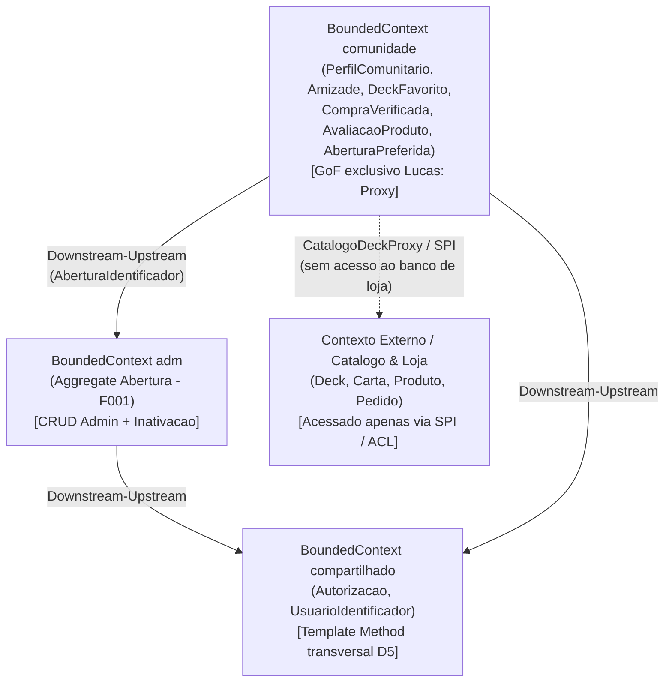

# Context Mapper e Arquitetura — TCGHub (Onda 2: Lucas Menezes)

Este documento consolida o projeto estratégico e tático (**DDD Estratégico + Tático + Clean Architecture**) das funcionalidades de **Lucas Menezes** no **TCGHub**, em conformidade com [.agents.md](../../.agents.md) e [tcghub/AGENTS.md](../../tcghub/AGENTS.md).

---

## 1. Modelos CML e DBML do Monorepo

| Artefato | Caminho | Escopo |
| :--- | :--- | :--- |
| **Raiz CML** | [tcghub/docs/projeto.cml](../../tcghub/docs/projeto.cml) | Importação global dos bounded contexts |
| **Compartilhado CML** | [tcghub/docs/compartilhado/projeto.cml](../../tcghub/docs/compartilhado/projeto.cml) | Domínio, subdomínios, `Autorizacao`, `UsuarioIdentificador` |
| **Administração CML** | [tcghub/docs/adm/projeto.cml](../../tcghub/docs/adm/projeto.cml) | `Abertura` (`F001` — CRUD admin e inativação) |
| **Comunidade CML** | [tcghub/docs/comunidade/projeto.cml](../../tcghub/docs/comunidade/projeto.cml) | `PerfilComunitario`, `Amizade`, `DeckFavorito`, `CompraVerificada`, `AvaliacaoProduto`, `AberturaPreferida` + Proxies |
| **Loja CML** | [tcghub/docs/loja/projeto.cml](../../tcghub/docs/loja/projeto.cml) | Subdomínio paralelo (`Ricardo Freitas`) |
| **Banco DBML** | [tcghub/docs/adm/projeto.dbml](../../tcghub/docs/adm/projeto.dbml), [tcghub/docs/comunidade/projeto.dbml](../../tcghub/docs/comunidade/projeto.dbml), [tcghub/docs/projeto.dbml](../../tcghub/docs/projeto.dbml) | Esquema relacional normalizado (`ABR_`, `PCM_`, `PCF_`, `AMI_`, `DFA_`, `CVE_`, `AVA_`, `APR_`) |

---

## 2. Diagrama de Contextos Delimitados e Contratos SPI (Sem Ciclos)

> [!IMPORTANT]
> - **Ausência de ciclos**: `comunidade` depende de `adm` e `compartilhado`; `adm` depende apenas de `compartilhado`. A verificação de RN006 em `adm` (`AberturaRepository.possuiEscolhaPorUsuario`) é declarada como contrato no domínio `adm` e implementada na camada `infraestrutura`, preservando o grafo acíclico entre módulos de domínio.
> - **Isolamento de banco**: Nenhuma entidade ou repositório de `comunidade` acessa tabelas de `loja`. Referências a `Carta`, `Deck`, `Produto` e `Pedido` utilizam objetos de valor de identidade (`CartaIdentificador`, `DeckIdentificador`, `ProdutoIdentificador`, `PedidoIdentificador`), a projeção local `CompraVerificada` e SPIs mediadas por **Proxy**.

---

## 3. Aplicação dos Padrões GoF (Trava Onda 2)

### 3.1 Padrão Exclusivo de Lucas Menezes: **Proxy** (ZERO `Observer`)

| Funcionalidade | Subdomínio | Agregados | Proxy Arquitetural | Responsabilidade do Proxy |
| :--- | :--- | :--- | :--- | :--- |
| **F001 — Perfil e amigos** | `comunidade` | `PerfilComunitario`, `Amizade` | `PerfilComunitarioVisibilidadeProxy` | Proxy de proteção e visibilidade: distingue leitura pública (visitante) de visão completa do proprietário, oculta blocos privados e bloqueia mutações não autorizadas. |
| **F002 — Decks favoritos** | `comunidade` | `DeckFavorito` | `CatalogoDeckProxy` | Proxy de integração/ACL sobre SPI do Catálogo: pesquisa decks ativos, valida elegibilidade e obtém composição (líder, cartas, quantidades, preços) sem acessar o banco do Catálogo e tratando indisponibilidade. |
| **F003 — Avaliação de cartas** | `comunidade` | `AvaliacaoProduto`, `CompraVerificada` | `AvaliacaoElegibilidadeProxy` | Proxy de controle de acesso/elegibilidade: intercepta gravação/atualização de avaliação verificando na projeção `CompraVerificada` se há pedido pago e não reembolsado antes de delegar ao `AvaliacaoProdutoServico`. |
| **F004 — Abertura preferida (comunidade + adm)** | `comunidade` + `adm` | `AberturaPreferida`, `Abertura` | `AberturaPreferidaPrivacidadeProxy` | Proxy de privacidade e autorização: oculta abertura do perfil público e da correspondência de amigos quando ocultada pelo dono, sem removê-la do cálculo anônimo do ranking Top 5, além de restringir novas escolhas às aberturas ativas de `adm`. |

### 3.2 Padrão Transversal Compartilhado: **Template Method**
- Aplicado exclusivamente na camada compartilhada/transversal do framework **D5** (`AgregadoServicoAbstrato`, `AgregadoRepositorioAbstrato` e `AgregadoAplicacaoRepositorioAbstrato`), padronizando o esqueleto invariante de autorização → existência → invariantes/estado → persistência/projeção e delegando extensões aos métodos ganchos (`validarInclusao`, `validarAlteracao`, `validarInclusaoAlteracao`, `validarExclusao`, `paraJpa`, `paraAgregado`).

---

## 4. Resumo de Agregados, Identificadores e Rotas D5

| Subdomínio | Funcionalidade | Agregado (Entidade Raiz) | Identificador | Prefixo DBML | Rota Base D5 |
| :--- | :--- | :--- | :--- | :--- | :--- |
| `adm` | [F001](../../tcghub/docs/adm/funcionalidades/F001.md) | `Abertura` | `AberturaIdentificador` | `ABR_` | `/adm/abertura/...` |
| `comunidade` | [F001](../../tcghub/docs/comunidade/funcionalidades/F001.md) | `PerfilComunitario` | `PerfilComunitarioIdentificador` | `PCM_`, `PCF_` | `/comunidade/perfil-comunitario/...` |
| `comunidade` | [F001](../../tcghub/docs/comunidade/funcionalidades/F001.md) | `Amizade` | `AmizadeIdentificador` | `AMI_` | `/comunidade/amizade/...` |
| `comunidade` | [F002](../../tcghub/docs/comunidade/funcionalidades/F002.md) | `DeckFavorito` | `DeckFavoritoIdentificador` | `DFA_` | `/comunidade/deck-favorito/...` |
| `comunidade` | [F003](../../tcghub/docs/comunidade/funcionalidades/F003.md) | `AvaliacaoProduto` | `AvaliacaoProdutoIdentificador` | `AVA_` | `/comunidade/avaliacao-produto/...` |
| `comunidade` | [F003](../../tcghub/docs/comunidade/funcionalidades/F003.md) | `CompraVerificada` | `CompraVerificadaIdentificador` | `CVE_` | *(projeção interna)* |
| `comunidade` | [F004](../../tcghub/docs/comunidade/funcionalidades/F004.md) | `AberturaPreferida` | `AberturaPreferidaIdentificador` | `APR_` | `/comunidade/abertura-preferida/...` |
