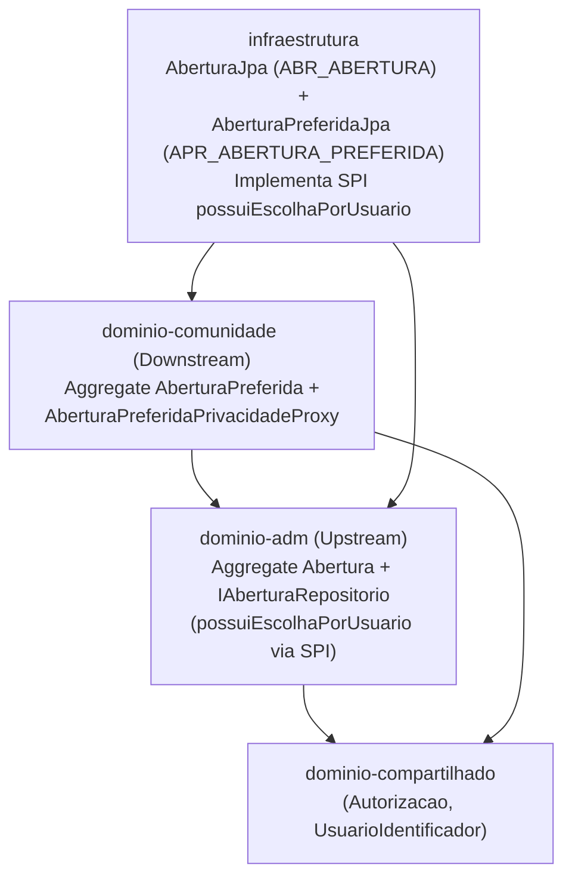

# Plano Técnico de Implementação — Etapa 3.3: Aberturas de One Piece (`adm / F001` + `comunidade / F004`)

> [!IMPORTANT]
> Este plano unifica a arquitetura, a rastreabilidade, os contratos REST/AnimeThemes e a estratégia de testes e entregas da **Etapa 3.3**, composta por **`adm / F001 — Gestão administrativa de aberturas de One Piece`** e **`comunidade / F004 — Abertura preferida do anime One Piece`** (Lucas Menezes), em estrita conformidade com [.agents.md](../../.agents.md), [tcghub/AGENTS.md](../../tcghub/AGENTS.md), [adm/F001.md](../../tcghub/docs/adm/funcionalidades/F001.md), [comunidade/F004.md](../../tcghub/docs/comunidade/funcionalidades/F004.md), [adm/projeto.cml](../../tcghub/docs/adm/projeto.cml), [comunidade/projeto.cml](../../tcghub/docs/comunidade/projeto.cml), [adm/projeto.dbml](../../tcghub/docs/adm/projeto.dbml), [comunidade/projeto.dbml](../../tcghub/docs/comunidade/projeto.dbml) e [prototipos/README.md](../prototipos/README.md).
> **Restrição desta etapa**: Nenhuma linha de código Java ou React deve ser criada antes da aprovação deste plano pelo `@supervisor` (Etapa 2).

---

## 1. Escopo e Matriz de Rastreabilidade Rigorosa (100%)

A Etapa 3.3 entrega duas funcionalidades completas (escrita, validações, regras de privacidade/autorização e leitura) em dois subdomínios com dependência estritamente unidirecional (`comunidade → adm`):
- **`adm / F001`**: **6 Regras de Negócio (`RN001`–`RN006`)**, **19 cenários BDD** (46 steps em [AberturaStepDefinitions.java](../../tcghub/dominio-adm/src/test/java/com/cesar/tgchub/tcghub/dominio/adm/abertura/AberturaStepDefinitions.java)), tabela `ABR_ABERTURA`, protótipos `P15`–`P16`.
- **`comunidade / F004`**: **6 Regras de Negócio (`RN001`–`RN006`)**, **16 cenários BDD** (52 steps em [AberturaPreferidaStepDefinitions.java](../../tcghub/dominio-comunidade/src/test/java/com/cesar/tgchub/tcghub/dominio/comunidade/aberturapreferida/AberturaPreferidaStepDefinitions.java)), tabela `APR_ABERTURA_PREFERIDA`, protótipos `P17`–`P18` + bloco no Perfil Comunitário (`P01`).
- **Total BDD da Etapa 3.3**: **35 cenários** (`19` em `dominio-adm` + `16` em `dominio-comunidade`).

### 1.1 Matriz — `adm / F001` (`abertura.feature` — 19 cenários)

| Regra de Negócio (`adm/F001.md`) | Cenários BDD (`abertura.feature`) | CML (`adm/projeto.cml`) | DBML (`adm/projeto.dbml`) | Protótipos / UI |
| :--- | :--- | :--- | :--- | :--- |
| **RN001 — Cadastro e edição completos pelo administrador** | 1. Cadastrar abertura ativa 2. Cadastrar abertura inicialmente inativa 5. Rejeitar número inválido (`<= 0`) ou campos obrigatórios vazios 6. Consultar abertura por número 7. Rejeitar consulta de abertura inexistente 8. Pesquisar e filtrar aberturas administrativas por status 9. Editar dados de abertura existente 11. Rejeitar edição de abertura inexistente | `Abertura`, `AberturaIdentificador`, `AberturaServico.incluir/buscar/alterar`, `AberturaRepository` | `ABR_ABERTURA` (`ABR_ID`, `ABR_NR`, `ABR_NM`, `ABR_ARTISTA`, `ABR_EPISODIOS`, `ABR_IMAGEM`, `ABR_VIDEO`, `ABR_ATIVA`) | `P15`, `P16` (`/adm/aberturas`) |
| **RN002 — Autorização administrativa exclusiva** | 3. Rejeitar cadastro sem `ADMINISTRADOR` 10. Rejeitar edição sem `ADMINISTRADOR` 15. Rejeitar inativação sem `ADMINISTRADOR` 19. Rejeitar exclusão sem `ADMINISTRADOR` | `AberturaAutorizacoes` (`Autorizacao.ADMINISTRADOR`), `AberturaServico.criarAutorizacoes` | Controle em domínio/BFF (sem tabela extra) | `P15`, `P16` (menu e ações restritas a `ADMINISTRADOR`) |
| **RN003 — Unicidade do número da abertura** | 4. Rejeitar cadastro com número já existente 12. Rejeitar alteração do número para número de outra abertura já cadastrada | `AberturaRepository.existePorNumero(int numero, Optional<AberturaIdentificador>)` | `ABR_NR int [not null, unique]` | `P16` (validação de conflito `409`) |
| **RN004 — Disponibilidade restrita a aberturas ativas na comunidade** | 2. Cadastrar abertura inicialmente inativa 8. Filtrar por status inativa *(complementado em `comunidade/F004` cenários 1, 4 e 15)* | `Abertura.ativa`, `AberturaPreferidaPrivacidadeProxy` | `ABR_ATIVA boolean [not null]` | `P15`, `P17` |
| **RN005 — Inativação e reativação administrativas** | 13. Inativar abertura existente (mesmo já escolhida) 14. Reativar abertura inativa 16. Rejeitar inativação de abertura inexistente | `Abertura.inativar()`, `Abertura.reativar()`, `AberturaServico.inativar/reativar` | `ABR_ATIVA` atualizado para `false`/`true` | `P15` (botões Inativar / Reativar) |
| **RN006 — Preservação contra exclusão de abertura já escolhida** | 17. Excluir abertura nunca escolhida por usuários 18. Rejeitar exclusão de abertura já escolhida por usuários (orientar inativação) | `AberturaRepository.possuiEscolhaPorUsuario(AberturaIdentificador)` / SPI `IAberturaVinculoConsulta` | Consulta em `APR_ABERTURA_PREFERIDA.ABR_ID` implementada na camada `infraestrutura` (zero ciclo de domínio) | `P15` (alerta informativo bloqueando exclusão quando `preferencias > 0`) |

### 1.2 Matriz — `comunidade / F004` (`abertura-preferida.feature` — 16 cenários)

| Regra de Negócio (`comunidade/F004.md`) | Cenários BDD (`abertura-preferida.feature`) | CML (`comunidade/projeto.cml`) | DBML (`comunidade/projeto.dbml`) | Protótipos / UI |
| :--- | :--- | :--- | :--- | :--- |
| **RN001 — Escolha restrita a aberturas ativas** | 1. Listar apenas aberturas ativas com contagem de amigos 2. Pesquisar aberturas ativas por nome ou artista 3. Escolher abertura ativa como preferida 4. Rejeitar escolha de abertura inativa 5. Rejeitar escolha de abertura inexistente | `AberturaPreferida`, `AberturaPreferidaServico.escolher`, `AberturaPreferidaPrivacidadeProxy` | `APR_ABERTURA_PREFERIDA.ABR_ID` → `ABR_ABERTURA.ABR_ID` (`ABR_ATIVA = true` para novas escolhas) | `P17` (`/comunidade/aberturas`) |
| **RN002 — Máximo 1 preferida por usuário (substituição direta)** | 6. Substituir abertura preferida atual por outra abertura ativa (mantendo apenas 1) | `AberturaPreferidaRepository.existePorUsuario/buscarPorUsuario` | `APR_USR_ID varchar(100) [not null, unique]` | `P17`, `P18` |
| **RN003 — Exibição e ocultação no perfil via Proxy** | 7. Ocultar abertura preferida do perfil público sem perder a escolha 8. Reexibir abertura preferida no perfil público | `AberturaPreferida.visivelNoPerfil`, `AberturaPreferidaServico.alterarVisibilidade`, `AberturaPreferidaPrivacidadeProxy.consultarAberturaNoPerfil` | `APR_VISIVEL_NO_PERFIL boolean [not null]` | `P01` (card no perfil), `P17` (toggle), `P18` |
| **RN004 — Ranking Top 5 com cômputo anônimo de ocultos** | 9. Consultar ranking Top 5 com quantidades, percentuais e escolhas ocultas contabilizadas sem expor nome 10. Consultar ranking quando não existem escolhas (vazio, total 0) | `ItemRankingAbertura`, `AberturaPreferidaServico.consultarRankingTop5()` | Agregação `COUNT(*) GROUP BY ABR_ID ORDER BY COUNT(*) DESC LIMIT 5` sobre todos os registros de `APR_ABERTURA_PREFERIDA` | `P17` (sidebar Ranking Top 5), `P18` |
| **RN005 — Amigos com a mesma preferência** | 1. Listagem de escolha com contagem de amigos 11. Indicar no perfil do amigo quando possui mesma abertura pública 12. Não indicar correspondência quando abertura é diferente 13. Não expor correspondência no perfil público do amigo quando ele ocultou 14. Detalhes com posição no ranking e amigos que escolheram | `AberturaPreferidaPrivacidadeProxy.amigosPossuemMesmaPreferencia/contarAmigosComAbertura` + `IAmizadeRepositorio` | Junção lógica `APR_ABERTURA_PREFERIDA` × `AMI_AMIZADE` (`AMI_STATUS = 'ACEITA'`) filtrada por `APR_VISIVEL_NO_PERFIL` | `P01` (badge no perfil do amigo), `P17`, `P18` |
| **RN006 — Preservação após inativação administrativa** | 15. Manter escolha existente quando abertura é inativada, bloqueando apenas novas escolhas 16. Usuário com abertura inativada pode substituí-la por outra abertura ativa | `AberturaPreferida` preserva `AberturaIdentificador`; `escolher` valida `abertura.isAtiva()` apenas na nova escolha | FK `APR_ABERTURA_PREFERIDA.ABR_ID` permanece íntegra após `ABR_ATIVA = false` | `P01`, `P17` (badge *Inativa para novas escolhas*), `P18` |

---

## 2. Grafo Acíclico de Subdomínios e Isolamento

- **Regra Maven**:
  - `tcghub/dominio-comunidade/pom.xml` passa a declarar dependência unidirecional em `tcghub-dominio-adm` (`comunidade Downstream-Upstream adm`).
  - `tcghub/dominio-adm/pom.xml` **NUNCA** depende de `tcghub-dominio-comunidade` (mantém apenas `tcghub-dominio-compartilhado`).
  - Em `adm`, `IAberturaRepositorio.possuiEscolhaPorUsuario(AberturaIdentificador)` (ou SPI dedicada `IAberturaVinculoConsulta` no pacote `dominio.adm.abertura.spi`) é declarada sem mencionar tipos de `comunidade` e implementada em `infraestrutura` consultando `IAberturaPreferidaRepositorioJpa.existsByAberturaIdentificador(Long)`. **Zero ciclo entre domínios!**

---

## 3. Trava Rígida de Padrões GoF e Clean Architecture D5

### 3.1 Padrão Exclusivo de Lucas Menezes: **Proxy** *(ZERO `Observer`)*
1. **`IAberturaPreferidaPrivacidadeProxy` / `AberturaPreferidaPrivacidadeProxy`** (`com.cesar.tgchub.tcghub.dominio.comunidade.aberturapreferida`):
   - **RealSubject / Colaboradores**: `AberturaPreferidaServico`, `IAberturaPreferidaRepositorio`, `IAberturaRepositorio` (de `dominio-adm`) e `IAmizadeRepositorio`.
   - **Responsabilidades do Proxy (Proteção de Privacidade e Acesso)**:
     - `consultarAberturaNoPerfil(UsuarioIdentificador solicitante, UsuarioIdentificador alvo)`: retorna a abertura preferida completa se `solicitante.equals(alvo)` (incluindo flag `visivelNoPerfil` e indicador se foi inativada); para visitante (`!solicitante.equals(alvo)`), **oculta** retornando `Optional.empty()` sempre que `visivelNoPerfil == false` (`RN003`).
     - `amigosPossuemMesmaPreferencia(UsuarioIdentificador solicitante, UsuarioIdentificador amigo)`: retorna `true` **somente** se forem amigos ativos (`StatusAmizade.ACEITA`), ambos possuírem a mesma abertura **e** a abertura do amigo estiver com `visivelNoPerfil == true` (`RN005`, cenário 13).
     - `contarAmigosComAbertura(UsuarioIdentificador usuario, AberturaIdentificador abertura)` e `listarAmigosComAbertura(...)`: calcula a contagem de amigos com a mesma abertura para `P17`/`P18` respeitando privacidade (perfis que ocultaram não têm identidade vazada).
     - `listarAberturasAtivasParaEscolha(UsuarioIdentificador usuario, Optional<String> termo)`: filtra exclusivamente aberturas com `ativa == true` de `adm` (`RN001`/`RN006`) e enriquece com contagem de amigos.
     - `alterarVisibilidade(UsuarioIdentificador solicitante, UsuarioIdentificador alvo, boolean visivel)` e `escolher(UsuarioIdentificador solicitante, UsuarioIdentificador alvo, AberturaIdentificador abertura)`: exige `solicitante.equals(alvo)` antes de delegar ao `AberturaPreferidaServico`.
2. **`IAnimeThemesCatalogoProxy` / `AnimeThemesCatalogoProxy`** *(opcional/auxiliar — também estritamente `Proxy`, Java puro, sem `Observer`)*:
   - Caso seja exposta importação/sugestão de metadados da **AnimeThemes API** no painel administrativo (`P16`), media o acesso HTTP externo via SPI `IAnimeThemesConsulta` com cache e fallback seguro para o catálogo curado offline, mantendo `dominio-adm` livre de acoplamento HTTP/Spring.
- **Registro Spring D5**: todas as classes de `dominio-adm` e `dominio-comunidade` permanecem **100% livres de anotações Spring** (`@Service`, `@Repository`, `@Component`, `@Transactional`). Proxies são registrados via `@Bean` em `ComunidadeConfiguracao` (`ui-backend`) e SPIs auxiliares em `ComunidadeInfraConfiguracao` (`infraestrutura`).

### 3.2 Padrão Transversal Compartilhado: **Template Method**
- Aplicado exclusivamente pelas superclasses base do framework **D5** (`AgregadoServicoAbstrato`, `AgregadoRepositorioAbstrato`, `AgregadoAplicacaoRepositorioAbstrato`).

### 3.3 Proibição Absoluta de `Observer`
- **ZERO** uso de `Observer`, `ApplicationEventPublisher`, `@EventListener` ou padrão publisher-subscriber nas funcionalidades de Lucas.

---

## 4. Contrato Oficial — AnimeThemes API (`https://api.animethemes.moe`)

- **Endpoint de referência**:
  `GET https://api.animethemes.moe/anime/one_piece?include=animethemes.song.artists,animethemes.animethemeentries.videos,images`
- **Mapeamento canônico de campos**:

| Campo AnimeThemes API | Campo no Domínio (`Abertura`) | Coluna DBML (`ABR_ABERTURA`) | Exemplo |
| :--- | :--- | :--- | :--- |
| `sequence` / `slug` (`OP1`, `OP2`...) | `numero` (`int > 0`, único) | `ABR_NR` | `1` (`OP1`) |
| `song.title` | `nome` (`String`) | `ABR_NM` | `"We Are!"` |
| `song.artists[].name` | `artista` (`String`) | `ABR_ARTISTA` | `"Hiroshi Kitadani"` |
| `animethemeentries[].episodes` | `episodios` (`String`) | `ABR_EPISODIOS` | `"1 a 47"` |
| `images[].link` | `imagem` (`String`) | `ABR_IMAGEM` | URL capa 16:9 oficial AnimeThemes |
| `animethemeentries[].videos[].link` | `video` (`String`) | `ABR_VIDEO` | URL vídeo/stream oficial AnimeThemes (`v.animethemes.moe/...`) |

- **Seed Inicial Idempotente (`ComunidadeConfiguracao`) + Fallback Offline**:
  - Provisionar automaticamente no startup (se ausentes por `numero`) aberturas icônicas de One Piece com metadados reais do contrato AnimeThemes:
    1. `#1 — We Are!` (*Hiroshi Kitadani*, ep. `1 a 47`, ativa)
    2. `#2 — Believe` (*Folder5*, ep. `48 a 115`, ativa)
    3. `#3 — Hikari e` (*The Babystars*, ep. `116 a 168`, ativa)
    4. `#6 — Brand New World` (*D-51*, ep. `264 a 278`, ativa)
    5. `#15 — We Go!` (*Hiroshi Kitadani*, ep. `517 a 590`, ativa)
    6. `#20 — Hope` (*Namie Amuro*, ep. `807 a 855`, ativa)
    7. `#22 — OVER THE TOP` (*Hiroshi Kitadani*, ep. `892 a 934`, ativa)
    8. `#26 — UUUUUS!` (*Hiroshi Kitadani*, ep. `1089 a 1122`, ativa)
  - Associar escolha inicial idempotente para `lucas` (`#1 We Are!`, visível) e `ricardo` (`#1 We Are!`, visível) e `thiago` (`#22 OVER THE TOP`, visível) para que Ranking Top 5, contagem de amigos e correspondência no perfil funcionem ao vivo imediatamente após o boot Docker, mantendo testes unitários/BDD/JPA 100% determinísticos sem dependência de rede externa.

---

## 5. Inventário Completo por Módulo

> Todos os novos pacotes `src/main/java` devem possuir `package-info.java` com `@NullMarked` (verificado por NullAway `0.14.1`) e seguir programação defensiva (`Objects.requireNonNull`, `Validate.*`, `Optional` no domínio, `@Nullable` apenas em JPA/JPQL/DTOs REST).

### 5.1 `tcghub/dominio-adm`
- **Pacote `com.cesar.tgchub.tcghub.dominio.adm.abertura`** (`@NullMarked`):
  - `AberturaIdentificador extends ObjetoValorStringAbstrato implements IIdentificador`
  - `Abertura implements IAgregado<AberturaIdentificador>`: `Optional<AberturaIdentificador> identificador`, `int numero` (`Validate.isTrue(numero > 0)`), `String nome`, `String artista`, `String episodios`, `String imagem`, `String video`, `boolean ativa`; métodos ricos `editar(...)`, `inativar()`, `reativar()`.
  - `AberturaAutorizacoes extends AgregadoAutorizacoes<Abertura>` (incluindo `inativar`, `reativar`; escrita apenas `Autorizacao.ADMINISTRADOR`, leitura `buscar = true`).
  - `AberturaServico extends AgregadoServicoAbstrato<AberturaIdentificador, Abertura, AberturaAutorizacoes>`:
    - Constantes públicas: `IDENTIFICADOR_INEXISTENTE_MODELO`, `IDENTIFICADOR_EXISTENTE_MODELO`, `NUMERO_EXISTENTE_MODELO`, `NUMERO_INEXISTENTE_MODELO`, `ABERTURA_JA_ESCOLHIDA_EXCLUSAO_MODELO`.
    - Valida unicidade de `numero` (`existePorNumero(numero, identificadorIgnorado)`), autorização `ADMINISTRADOR` em `incluir`/`alterar`/`excluir`/`inativar`/`reativar`, e em `validarExclusao` rejeita com `IllegalStateException` se `repositorio.possuiEscolhaPorUsuario(identificador)` (`RN006`).
    - Métodos adicionais: `buscarPorNumero(int numero)`, `inativar(AberturaIdentificador)`, `reativar(AberturaIdentificador)`, `listarPorStatus(Optional<Boolean> ativa)`, `listarAtivas()`.
- **Pacote `com.cesar.tgchub.tcghub.dominio.adm.abertura.spi`** (`@NullMarked`):
  - `IAberturaRepositorio extends IAgregadoRepositorio<AberturaIdentificador, Abertura>`: `existePorNumero(int, Optional<AberturaIdentificador>)`, `buscarPorNumero(int)`, `existePorNumero(int)`, `possuiEscolhaPorUsuario(AberturaIdentificador)`, `listarTodas()`, `listarPorStatus(boolean ativa)`.

### 5.2 `tcghub/dominio-comunidade`
- **Dependência Maven**: adicionar `tcghub-dominio-adm` em `tcghub/dominio-comunidade/pom.xml`.
- **Pacote `com.cesar.tgchub.tcghub.dominio.comunidade.aberturapreferida`** (`@NullMarked`):
  - `AberturaPreferidaIdentificador extends ObjetoValorStringAbstrato implements IIdentificador`
  - `ItemRankingAbertura` (`AberturaIdentificador abertura`, `int numero`, `String nome`, `String artista`, `int quantidadeEscolhas`, `BigDecimal percentual` — 1 casa decimal ex.: `40.0`)
  - `AberturaPreferidaDetalhesVisao` (VO com dados da abertura, `visivelNoPerfil`, `ehProprietario`, `mesmaPreferenciaDoSolicitante`, `posicaoRanking`, `totalEscolhasComunidade`, `amigosComMesmaPreferencia`)
  - `AberturaPreferida implements IAgregado<AberturaPreferidaIdentificador>`: `Optional<AberturaPreferidaIdentificador> identificador`, `UsuarioIdentificador usuario`, `AberturaIdentificador abertura`, `boolean visivelNoPerfil`, `Instant escolhidaEm`; métodos `substituirAbertura(AberturaIdentificador, Instant)`, `alterarVisibilidade(boolean)`.
  - `AberturaPreferidaAutorizacoes extends AgregadoAutorizacoes<AberturaPreferida>` (`escolher`, `ocultar`, `reexibir`).
  - `AberturaPreferidaServico extends AgregadoServicoAbstrato<AberturaPreferidaIdentificador, AberturaPreferida, AberturaPreferidaAutorizacoes>`:
    - `escolher(UsuarioIdentificador usuario, AberturaIdentificador abertura)` — valida existência e `abertura.isAtiva()` em `IAberturaRepositorio` (`RN001`/`RN006`), atualiza se já existir escolha para o usuário ou inclui nova (`RN002`).
    - `alterarVisibilidade(UsuarioIdentificador usuario, boolean visivelNoPerfil)` (`RN003`).
    - `consultarRankingTop5()` — contabiliza **todas** as escolhas (inclusive ocultas, sem expor identidades), ordena por quantidade decrescente (desempate por número crescente), limita a 5 itens e calcula percentual sobre o total geral (`RN004`).
  - **Proxy GoF**: `IAberturaPreferidaPrivacidadeProxy` + `AberturaPreferidaPrivacidadeProxy` (Java puro).
- **Pacote `com.cesar.tgchub.tcghub.dominio.comunidade.aberturapreferida.spi`** (`@NullMarked`):
  - `IAberturaPreferidaRepositorio extends IAgregadoRepositorio<AberturaPreferidaIdentificador, AberturaPreferida>`: `existePorUsuario`, `buscarPorUsuario`, `listarTodas`, `contarPorAbertura`, `listarPorAbertura`.

### 5.3 `tcghub/aplicacao`
- `com.cesar.tgchub.tcghub.aplicacao.adm.abertura` (+ `.spi`, `@NullMarked`):
  - `AberturaProjecao` (incluindo `quantidadePreferencias`), `AberturaOrdenacao` (`NUMERO`, `NOME`), `AberturaConsulta` (filtros opcionais `termo` e `ativa`), `IAberturaAplicacaoRepositorio`, `AberturaAplicacaoServico`.
- `com.cesar.tgchub.tcghub.aplicacao.comunidade.aberturapreferida` (+ `.spi`, `@NullMarked`):
  - `AberturaPreferidaProjecao`, `AberturaPreferidaOrdenacao`, `AberturaPreferidaConsulta`, `IAberturaPreferidaAplicacaoRepositorio`, `AberturaPreferidaAplicacaoServico`.

### 5.4 `tcghub/infraestrutura`
- `com.cesar.tgchub.tcghub.infraestrutura.adm.abertura` (`@NullMarked`):
  - `AberturaJpa implements IAgregadoJpa<Abertura>` (`@Table(name = "ABR_ABERTURA")`, `ABR_ID` identity, `ABR_NR` unique, `ABR_NM`, `ABR_ARTISTA`, `ABR_EPISODIOS`, `ABR_IMAGEM`, `ABR_VIDEO`, `ABR_ATIVA`).
  - `IAberturaRepositorioJpa extends JpaRepository<AberturaJpa, Long>` (queries com `escape '\\'` para busca por nome/artista/número e filtro de status).
  - `AberturaRepositorio extends AgregadoRepositorioAbstrato<...>` — injeta `IAberturaRepositorioJpa` **e** `IAberturaPreferidaRepositorioJpa` para implementar `possuiEscolhaPorUsuario(AberturaIdentificador)` sem criar ciclo nos módulos de domínio!
  - `AberturaAplicacaoRepositorio extends AgregadoAplicacaoRepositorioAbstrato<...>`.
- `com.cesar.tgchub.tcghub.infraestrutura.comunidade.aberturapreferida` (`@NullMarked`):
  - `AberturaPreferidaJpa implements IAgregadoJpa<AberturaPreferida>` (`@Table(name = "APR_ABERTURA_PREFERIDA")`, `APR_ID` identity, `APR_USR_ID` unique, `@ManyToOne(fetch = FetchType.LAZY) @JoinColumn(name = "ABR_ID")` para `AberturaJpa`, `APR_VISIVEL_NO_PERFIL`, `APR_ESCOLHIDA_EM`).
  - `IAberturaPreferidaRepositorioJpa extends JpaRepository<AberturaPreferidaJpa, Long>` (incluindo `existsByAberturaIdentificador(Long)`, `countByAberturaIdentificador(Long)`, `findByUsuario(String)`).
  - `AberturaPreferidaRepositorio`, `AberturaPreferidaAplicacaoRepositorio`.

### 5.5 `tcghub/ui-backend`
- **Wiring & Segurança**:
  - `ComunidadeConfiguracao`: registrar `@Bean IAberturaPreferidaPrivacidadeProxy` e executar seed idempotente das 8 aberturas oficiais One Piece (AnimeThemes) + escolhas iniciais para `lucas`, `ricardo` e `thiago`.
  - `AutenticacaoRecurso` e `AutenticacaoControlador`: expor `abertura` (`AberturaAutorizacoes`) e `aberturaPreferida` (`AberturaPreferidaAutorizacoes`) em `GET /backend/autenticacao` para que o frontend exiba o menu `/adm/aberturas` **somente** quando `autorizacoesDe('abertura')?.incluir` (`ADMINISTRADOR`).
- **`AberturaControlador`** (`@RestController @RequestMapping(Backend.PREFIXO + "adm/abertura")`):
  - `GET /pesquisa?termo=&status=` — listagem paginada/filtrada (`TODAS`, `ATIVAS`, `INATIVAS`) com contagem `preferencias` e contadores totais (`total`, `ativas`, `inativas`).
  - `GET /{identificador}/visualizacao` — detalhes administrativos.
  - `POST /incluir` — cadastra abertura (`ADMINISTRADOR`, valida número único `409` e campos obrigatórios `400`).
  - `POST /{identificador}/alterar` — edita abertura (`ADMINISTRADOR`).
  - `POST /{identificador}/inativar` e `POST /{identificador}/reativar` (`ADMINISTRADOR`).
  - `POST /{identificador}/excluir` — exclui apenas se `preferencias == 0`, caso contrário rejeita `409`/`400` (`RN006`).
- **`AberturaPreferidaControlador`** (`@RestController @RequestMapping(Backend.PREFIXO + "comunidade/abertura-preferida")`):
  - `GET /pesquisa?termo=&filtro=` — retorna abertura preferida atual do usuário autenticado (com `visivelNoPerfil`, `ativa` e detalhes), lista de aberturas **ativas** filtradas com `quantidadeAmigos`, e resumo do ranking.
  - `GET /ranking` — retorna `{ totalEscolhas, itens: [top 5 com posicao, abertura, quantidadeEscolhas, percentual] }` (`RN004`).
  - `GET /perfil/{perfilId}` — retorna a abertura preferida visível no perfil consultado + `mesmaPreferenciaDoVisitante` filtrados pelo `AberturaPreferidaPrivacidadeProxy` (`RN003`, `RN005`).
  - `GET /{identificador}/visualizacao` — detalhes da abertura (artista, episódios, imagem, vídeo AnimeThemes, posição no ranking, amigos visíveis que escolheram, `ehMinhaPreferida`, `visivelNoPerfil`).
  - `POST /escolher` — body `{ aberturaId }` (ou `{ numero }`) → define/substitui abertura preferida ativa (`RN001`, `RN002`, `RN006`).
  - `POST /ocultar` e `POST /reexibir` — alterna `visivelNoPerfil` sem perder a escolha (`RN003`).

### 5.6 `/frontend/` (Standalone — React 19 + Vite + Tailwind CSS v4 Stitch + TanStack Query + Zustand)
- **Stores Zustand (`frontend/src/stores/openingsUiStore.ts`)** — somente estado efêmero de UI:
  - Comunidade: `termoBusca`, `filtroComunidade` (`'todas' | 'amigos' | 'ranking'`), `aberturaDetalheId`, `modalDetalhesAberto`.
  - Admin: `termoBuscaAdmin`, `filtroStatusAdmin` (`'todas' | 'ativas' | 'inativas'`), `modalAdminAberto`, `aberturaEmEdicao`, `alvoExclusaoAdmin`.
- **Feature Comunidade (`frontend/src/features/community/openings/`)**:
  - `types/openings.types.ts`, `api/openingsApi.ts`, `api/openingsQueries.ts` (`chamarApi`, `queryOptions`, `ensureQueryData`, `useSuspenseQuery`, `useMutation` invalidando `['comunidade', 'abertura-preferida']` e `['comunidade', 'perfil-comunitario']`).
  - `pages/FavoriteOpeningsPage.tsx` (rota `/comunidade/aberturas`, com redirect legado `/comunidade/abertura-preferida` → `/comunidade/aberturas`): Banner da preferência atual + toggle `Exibir no Perfil Público`, barra de busca por nome/artista, grid de aberturas ativas com contagem de amigos e botão `Escolher como Preferida`, sidebar `Ranking Top 5 da Comunidade` (quantidades, barras proporcionais, percentuais e nota de anonimato de perfis ocultos).
  - `components/OpeningDetailsModal.tsx` (modal de detalhes: capa 16:9, player/link vídeo AnimeThemes, artista, episódios, posição no ranking, amigos que escolheram e toggle de visibilidade).
  - `components/FavoriteOpeningProfileCard.tsx` (integrado a `ProfilePage.tsx`: exibe abertura preferida no perfil, toggle de privacidade para o dono, badge `Mesma abertura preferida que você!` para amigo quando pública, link/player AnimeThemes; oculto para visitantes quando `visivelNoPerfil == false`).
- **Feature Admin (`frontend/src/features/adm/openings/`)**:
  - `types/adminOpenings.types.ts`, `api/adminOpeningsApi.ts`, `api/adminOpeningsQueries.ts`.
  - `pages/AdminOpeningsPage.tsx` (rota `/adm/aberturas`, protegida por autorização `ADMINISTRADOR`): pílulas `Todas / Ativas / Inativas`, busca, tabela estilizada Stitch com miniatura, `#Nº`, nome, artista, episódios, preferências, status e ações (`Editar`, `Inativar/Reativar`, `Excluir` com feedback `RN006`).
  - `components/AdminOpeningFormModal.tsx` (`React Hook Form`: campos AnimeThemes `numero`, `nome`, `artista`, `episodios`, `imagem` + botão `Testar Prévia`, `video`, checkbox `Ativa para novas escolhas`).
- **Rotas e Menu (`frontend/src/routes/index.tsx`, `CommunitySubNav.tsx`, `HeaderNavbar.tsx`)**:
  - Habilitar aba `Abertura Preferida` (`/comunidade/aberturas`) em `CommunitySubNav.tsx`.
  - Exibir item `Admin • Aberturas` (`/adm/aberturas`) no cabeçalho apenas quando `autorizacoesDe('abertura')?.incluir === true`.

---

## 6. Pontos Críticos de Atenção (Testes BDD & D5)

1. **Step Compartilhado no Cucumber (`dominio-comunidade`)**:
   - `abertura-preferida.feature` e `decks-favoritos.feature` compartilham o passo `Dado que existe o perfil comunitário do usuário {string} com apelido {string}` (atualmente definido em `DecksFavoritosStepDefinitions.java`).
   - Para evitar `DuplicateStepDefinitionException` e garantir isolamento de estado entre os cenários, o `@backend-dev` deve extrair um pequeno estado compartilhado de teste (ex.: `ComunidadeBddEstado` gerenciado em `dominio-comunidade/src/test/java` com `@Before` limpando os dados) ou delegar o cadastro do perfil nesse passo compartilhado para ambos os step definitions sem duplicar a anotação `@Dado`.
2. **Compilação Cross-Module**:
   - Ao adicionar `tcghub-dominio-adm` como dependência de `tcghub-dominio-comunidade`, compilar/instalar `dominio-adm` no fluxo Maven (`mvn test -pl dominio-adm,dominio-comunidade,dominio-loja` ou `mvn install -DskipTests -pl .,dominio-compartilhado,dominio-adm`) antes de rodar testes isolados de `dominio-comunidade`.
3. **Fallback de Mídia Externa**:
   - Imagens e vídeos da `https://api.animethemes.moe` devem possuir fallback visual elegante em caso de indisponibilidade de rede ou ambiente offline.

---

## 7. Plano de Testes e Critérios de Aceite

1. **BDD (`dominio-adm` e `dominio-comunidade`)**:
   - `abertura.feature`: **`19/19` cenários passando** (`0` falhas/erros/skipped, `0` `PendingException` nos 46 steps).
   - `abertura-preferida.feature`: **`16/16` cenários passando** (`0` falhas/erros/skipped, `0` `PendingException` nos 52 steps).
   - Regressão: `perfil-e-amigos.feature` (`26/26`), `decks-favoritos.feature` (`15/15`) e dry-run global (`143/143`).
2. **JPA (`infraestrutura`)**:
   - `@DataJpaTest` em `AberturaRepositorioTest`, `AberturaAplicacaoRepositorioTest`, `AberturaPreferidaRepositorioTest` e `AberturaPreferidaAplicacaoRepositorioTest` (incluindo unicidade de `ABR_NR`, unicidade de `APR_USR_ID`, FK `ABR_ID` e `possuiEscolhaPorUsuario`).
3. **REST BFF (`ui-backend`)**:
   - Testes em `AberturaControladoresTest` / `ComunidadeControladoresTest` cobrindo autorização `ADMINISTRADOR` vs. `USUARIO` (`403`), unicidade de número (`409`), bloqueio de exclusão já escolhida (`RN006`), escolha/substituição, ocultação/reexibição, ranking Top 5 com ocultos contabilizados sem vazamento e correspondência de amigos via `AberturaPreferidaPrivacidadeProxy`.
4. **Frontend (`Vitest` + Testing Library em `/frontend/`)**:
   - `openingsUiStore.test.ts`, `FavoriteOpeningsPage.test.tsx`, `OpeningDetailsModal.test.tsx`, `AdminOpeningsPage.test.tsx` + atualização de `ProfilePage.test.tsx`; `pnpm test` 100% verde e `pnpm build` limpo.
5. **Ambiente Docker Vivo**:
   - Rebuild e subida `docker compose --env-file .env -f compose.yaml up -d --build --wait` em `tcghub/` (mantendo containers ativos `:15432` e `:18080`) e verificação HTTP ao vivo dos endpoints `/backend/adm/abertura/pesquisa`, `/backend/comunidade/abertura-preferida/pesquisa` e `/backend/comunidade/abertura-preferida/ranking`.

---

## 8. Estratégia de Commits Incrementais (Conventional Commits em Inglês)

Sem `git push` e sem incluir `tcghub/.env` ou diretórios de build:
1. *(Planejamento)* `docs(plan): add Stage 3.3 technical plan and prototypes for One Piece openings`
2. *(Auditoria Planejamento)* `docs(reports): add Stage 3.3 planning audit report and AI interaction log`
3. *(Implementação)*:
   - `feat(adm): implement F001 Abertura domain model and business rules`
   - `test(bdd): automate F001 Abertura Cucumber StepDefinitions`
   - `feat(comunidade): implement F004 AberturaPreferida domain model and Privacy Proxy`
   - `test(bdd): automate F004 AberturaPreferida Cucumber StepDefinitions`
   - `feat(aplicacao): add CQRS projections and queries for Abertura and AberturaPreferida`
   - `feat(infraestrutura): add JPA persistence for ABR_ABERTURA and APR_ABERTURA_PREFERIDA`
   - `feat(ui-backend): add admin and community opening REST controllers and AnimeThemes seed`
   - `feat(frontend): implement community openings ranking, profile card, and admin panel`
   - `docs(reports): add Stage 3.3 implementation audit report and AI interaction log`
