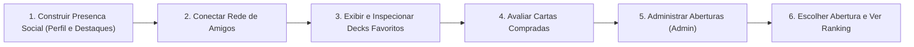
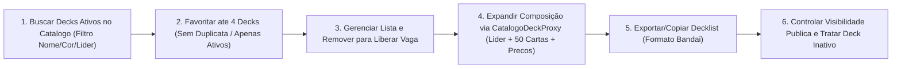
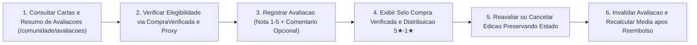
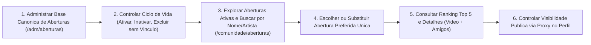

# Mapa da História do Usuário (User Story Map) — TCGHub

> [!NOTE]
> Artefato de **DDD Preliminar (Etapa 1 — Planejar, Onda 2)** cobrindo integralmente as **4 funcionalidades de Lucas Menezes** (`Perfil e amigos`, `Decks favoritos`, `Avaliação de cartas` e `Abertura preferida do anime One Piece`, incluindo a gestão administrativa em `adm`), em conformidade com [.agents.md](../../.agents.md) e [tcghub/AGENTS.md](../../tcghub/AGENTS.md).

---

## 1. Visão Geral e Princípios do Mapa

Todas as funcionalidades mapeadas entregam ciclos completos de **escrita (criação, edição, ativação/inativação, remoção), validação de invariantes de domínio e leitura/consulta**, vedando entregas exclusivamente de leitura:

- **Escopo**:
  1. `comunidade / F001`: **Perfil comunitário e rede de amigos** (`PerfilComunitario`, `Amizade`, `PerfilComunitarioVisibilidadeProxy`)
  2. `comunidade / F002`: **Decks favoritos** (`DeckFavorito`, `CatalogoDeckProxy`)
  3. `comunidade / F003`: **Avaliação de cartas** (`AvaliacaoProduto`, projeção `CompraVerificada`, `AvaliacaoElegibilidadeProxy`)
  4. `adm / F001` + `comunidade / F004`: **Abertura preferida do anime One Piece** (`Abertura`, `AberturaPreferida`, `AberturaPreferidaPrivacidadeProxy`)
- **Glossário base**: [docs/linguagem-onipresente/README.md](../linguagem-onipresente/README.md).
- **Funcionalidades pendentes de incorporação futura**: [docs/thiago-pendente/README.md](../thiago-pendente/README.md) (4 funcionalidades de Thiago Medeiros).

---

## 2. Backbone e Fluxo de Atividades

| Coluna do Backbone | Atividade do Usuário / Administrador | Subdomínio / Funcionalidade | Operações de Escrita & Validação | Operações de Leitura & Privacidade |
| :--- | :--- | :--- | :--- | :--- |
| **A1** | Construir presença social, editar dados e gerenciar destaques de cartas | `comunidade / F001` | Editar perfil, validar apelido único (*case-insensitive*), fixar/remover até 4 cartas | Visualizar próprio perfil, visualizar perfil público via Proxy |
| **A2** | Buscar colecionadores e administrar conexões bilaterais | `comunidade / F001` | Enviar solicitação, aceitar, recusar, cancelar, remover bilateralmente | Buscar colecionadores, listar amigos e solicitações pendentes/enviadas |
| **A3** | Selecionar até 4 decks favoritos e explorar composição | `comunidade / F002` | Adicionar deck ativo (máx. 4, sem duplicata), remover deck, ocultar/reexibir | Pesquisar decks ativos, expandir composição (líder, cartas, preços via SPI) |
| **A4** | Registrar e atualizar avaliações confiáveis de cartas | `comunidade / F003` | Avaliar (nota 1–5 + comentário), reavaliar, invalidar após reembolso | Consultar média, distribuição 5★–1★, selo *Compra Verificada* |
| **A5** | Manter base canônica de aberturas de One Piece | `adm / F001` | Cadastrar abertura (nº único), editar, inativar/reativar, excluir se sem uso | Pesquisar/filtrar por status (`Todas`, `Ativas`, `Inativas`), prévia de imagem |
| **A6** | Escolher abertura preferida e acompanhar comunidade/amigos | `comunidade / F004` | Escolher/substituir abertura ativa (1 por usuário), ocultar/reexibir no perfil | Listar ativas com contagem de amigos, ranking Top 5, detalhes e correspondência |

---

## 3. Mapa Detalhado por Funcionalidade e Fatia de Entrega

### 3.1 `comunidade / F001` — Perfil Comunitário e Rede de Amigos

| Atividade | Fatia 1 — Núcleo Funcional (Escrita + Leitura) | Fatia 2 — Vitrine Social e Validações | Fatia 3 — Privacidade e Proxy |
| :--- | :--- | :--- | :--- |
| **Perfil Comunitário** | **US-01**: Como usuário, quero consultar meu próprio perfil comunitário (`/comunidade/perfil-comunitario/visualizacao`) para visualizar apelido, cidade, descrição, foto, destaques e métricas. **US-02**: Como usuário, quero editar meu perfil (`/comunidade/perfil-comunitario/:id/alteracao`) atualizando foto, apelido, cidade, descrição e preferências públicas, ou cancelar preservando os dados anteriores. | **US-03**: Como usuário, quero que o sistema rejeite apelidos vazios ou já usados por outro usuário (inclusive variando maiúsculas/minúsculas, ex.: `ZoroTC` vs. `zorotc`). **US-04**: Como usuário, quero gerenciar meus **4 destaques de cartas favoritas** fixando cartas da minha coleção e removendo destaques para liberar espaço (sem duplicatas e com atalho `Ver no Catálogo`). | **US-05**: Como visitante, quero consultar o perfil público de outro colecionador (`/comunidade/perfil-comunitario/:id/visualizacao`) mediado pelo `PerfilComunitarioVisibilidadeProxy`. **US-06**: Como usuário, quero alternar preferências de visibilidade (ex.: *Wishlist pública com token seguro* e *Exibir Decks Favoritos no perfil*) e impedir edições não autorizadas em perfis alheios. |
| **Rede de Amigos** | **US-07**: Como usuário, quero buscar colecionadores (`/comunidade/amizade/pesquisa`) e enviar solicitação de amizade (`/comunidade/amizade/inclusao`), ficando com status `PENDENTE`. **US-08**: Como destinatário, quero aceitar uma solicitação pendente para estabelecer amizade bilateral entre os dois perfis. | **US-09**: Como destinatário, quero recusar uma solicitação recebida sem criar vínculo. **US-10**: Como solicitante, quero cancelar uma solicitação pendente enviada. **US-11**: Como usuário, quero impedir autoamizade, solicitações duplicadas ou solicitações para usuários inexistentes/já amigos. | **US-12**: Como usuário, quero remover um amigo e apagar a relação bilateralmente dos dois lados. **US-13**: Como sistema, quero bloquear aceitação ou cancelamento por usuários que não sejam parte autorizada da solicitação. |

### 3.2 `comunidade / F002` — Decks Favoritos (Detalhamento Etapa 3.2)

> [!NOTE]
> Detalhamento operacional da **Etapa 3.2 (`F002 — Decks favoritos`)** alinhado ao frontend standalone `/frontend/` (Design System Stitch *Nautical Blue & White Marketplace*, `projects/18247718655827442438`), ao padrão GoF exclusivo **`Proxy`** (`CatalogoDeckProxy` + `PerfilComunitarioVisibilidadeProxy`, **zero `Observer`**), ao contrato `https://optcgapi.com` (`/api/allDecks/`, `/api/decks/{st_id}/`), às regras oficiais Bandai (`1 Líder + 50 Cartas`, máximo de `4 cópias` por carta) e aos **15 cenários** de [decks-favoritos.feature](../../tcghub/dominio-comunidade/src/test/resources/features/decks-favoritos.feature).

| Atividade | Fatia 1 — Gestão dos Favoritos (Escrita + Leitura) | Fatia 2 — Integração Proxy (`optcgapi.com`) & Composição Bandai | Fatia 3 — Privacidade, Inativação e Autorização |
| :--- | :--- | :--- | :--- |
| **Catálogo e Inclusão (`P08`)** | **US-14**: Como usuário, quero abrir o modal/drawer de busca em `/comunidade/perfil` ou `/comunidade/decks-favoritos`, pesquisar decks **ativos** por nome, código, cor ou líder (`/api/allDecks/` via `CatalogoDeckProxy`) e clicar em **Favoritar** até atingir o limite de **4 decks** (`RN001`, `RN002`). **US-15**: Como usuário, quero remover um deck favorito da minha lista para liberar uma vaga e adicionar outro deck (`RN001`). | **US-16**: Como sistema, quero validar via `CatalogoDeckProxy` que o deck existe, está `ATIVO` e não está duplicado na lista do usuário, rejeitando o 5º deck, decks duplicados, decks inativos ou inexistentes (`RN001`, `RN002`). | **US-19**: Como sistema, quero bloquear qualquer inclusão, remoção ou alteração de visibilidade dos decks favoritos de outro usuário, rejeitando por falta de autorização (`RN005`). |
| **Composição e Exportação (`P09`)** | **US-17**: Como usuário ou visitante autorizado, quero expandir a composição de um deck favorito em modal dedicado (Stitch `d26c9d5f978f422fa021153ec9cfe885`) vendo líder, 50 cartas agrupadas por **tipo** ou **custo**, quantidades (máx. 4 cópias), preços unitários (`market_price`) e custo total estimado no mercado via `/api/decks/{st_id}/` (`RN003`). | **US-17b**: Como usuário, quero **copiar/exportar a decklist no formato oficial Bandai** (ex.: `1xOP01-001`, `4xOP01-016`) e abrir cada carta diretamente na página do catálogo (`Ver no Catálogo →`). **US-17c**: Como sistema, quero tratar de forma graciosa e explícita a indisponibilidade temporária da SPI do Catálogo (`CatalogoDeckProxy`), exibindo feedback claro sem quebrar a página (`RN003`). | **US-18**: Como usuário, quero **ocultar ou reexibir** meus decks favoritos no perfil público (persistido em `PCM_DECKS_FAVORITOS_VISIVEIS`) sem perder minha lista cadastrada — visitantes não veem decks ocultos enquanto eu continuo gerenciando-os (`RN004`). **US-19b**: Como usuário, quero visualizar um badge **Descontinuado / Inativo no Catálogo** caso um deck já favoritado se torne inativo posteriormente, preservando minha lista e bloqueando apenas novas inclusões por outros usuários (`RN002`). |

#### Rastreabilidade de Histórias da Etapa 3.2 ↔ Regras de Negócio ↔ Cenários BDD

| História | Regras (`comunidade/F002`) | Cenários de `decks-favoritos.feature` (15/15) | Protótipos / Telas |
| :--- | :--- | :--- | :--- |
| **US-14**, **US-15** | `RN001`, `RN002` | Adicionar um deck favorito; Pesquisar decks disponíveis; Adicionar até o limite de 4; Remover libera vaga; Rejeitar remoção de deck não favoritado | `P06`, `P07`, `P08` |
| **US-16** | `RN001`, `RN002` | Rejeitar 5º deck favorito; Rejeitar deck duplicado; Rejeitar deck inativo; Rejeitar deck inexistente | `P08` |
| **US-17**, **US-17b**, **US-17c** | `RN003` | Visualizar composição via interface do Catálogo; Tratar indisponibilidade da interface do Catálogo | `P09` |
| **US-18** | `RN004` | Ocultar decks favoritos no perfil público sem perder lista; Reexibir decks favoritos no perfil público | `P06`, `P07` |
| **US-19**, **US-19b** | `RN002`, `RN005` | Deck tornado inativo não fica disponível para novas escolhas; Rejeitar gestão de decks favoritos de outro usuário | `P07`, `P08` |

### 3.3 `comunidade / F003` — Avaliação de Cartas (Detalhamento Etapa 3.4)

> [!NOTE]
> Detalhamento operacional da **Etapa 3.4 (`comunidade / F003 — Avaliação de cartas`)** alinhado ao frontend standalone `/frontend/` (Design System Stitch *Nautical Blue & White Marketplace*, `projects/18247718655827442438`), ao desacoplamento total de `dominio-loja` via projeção local **`CompraVerificada`** (`CVE_COMPRA_VERIFICADA`), ao padrão GoF exclusivo **`Proxy`** (`AvaliacaoElegibilidadeProxy`, **zero `Observer`** inclusive na invalidação por reembolso da `RN005`), ao contrato **`https://optcgapi.com`** e aos **16 cenários BDD** de [avaliacao-de-cartas.feature](../../tcghub/dominio-comunidade/src/test/resources/features/avaliacao-de-cartas.feature).

| Atividade | Fatia 1 — Escrita: Avaliar e Reavaliar (`P13`, `P14`) | Fatia 2 — Elegibilidade Proxy e Selo (`P10`, `P11`, `P12`) | Fatia 3 — Média Comunitária, Reembolso e Segurança (`P12`, `P14`) |
| :--- | :--- | :--- | :--- |
| **Catálogo de Cartas e Avaliações** | **US-20**: Como comprador elegível, quero acessar `/comunidade/avaliacoes` (ou entrar via `Minha Coleção` / detalhes da carta) e registrar avaliação com **nota inteira de 1 a 5** (`NotaAvaliacao`) e comentário opcional (`RN001`, `RN003`). **US-21**: Como comprador que já avaliou a carta, quero abrir `Editar Minha Avaliação` e atualizar nota ou comentário de forma idempotente (sem duplicar minha contagem na média) ou clicar em `Cancelar` preservando integralmente a versão anterior (`RN002`, `RN003`). | **US-22**: Como sistema, quero interceptar inclusão e edição via **`AvaliacaoElegibilidadeProxy`** sobre a projeção local `CompraVerificada` (`CVE_COMPRA_VERIFICADA`), permitindo avaliar apenas quem possui ao menos um **pedido pago e não reembolsado** (`CVE_PAGA = true`, `CVE_REEMBOLSADA = false`) — rejeitando sem compra, pagamento pendente ou único pedido reembolsado (`RN001`). **US-23**: Como visitante, quero visualizar o selo **`Compra Verificada`** (`AVA_COMPRA_VERIFICADA = true`) em todas as avaliações válidas exibidas na comunidade (`RN006`). | **US-24**: Como visitante ou usuário, quero consultar o resumo de avaliações de qualquer carta (`ResumoAvaliacoesProduto`), exibindo média aritmética com 1 casa decimal (ou `0.0` quando vazia), contagem de avaliações válidas e histograma de distribuição `5★–1★` (`RN004`). **US-25**: Como sistema, quero que o reembolso do **único** pedido válido marque a avaliação como inválida (`AVA_VALIDA = false`) e recalcule a média/contagem (mantendo válida caso haja outra compra elegível), e quero bloquear qualquer edição de avaliação pertencente a outro usuário (`RN002`, `RN005`). |

#### Rastreabilidade Completa da Etapa 3.4 ↔ Regras de Negócio ↔ Cenários BDD (16/16)

| História | Regras (`comunidade/F003`) | Cenários de `avaliacao-de-cartas.feature` (16/16) | Protótipos / Telas |
| :--- | :--- | :--- | :--- |
| **US-20** | `RN001`, `RN003`, `RN006` | Registrar avaliação por comprador com pedido pago e não reembolsado; Registrar avaliação sem comentário opcional; Registrar avaliação com nota mínima válida 1; Rejeitar nota menor que 1; Rejeitar nota maior que 5 | `P10`, `P11`, `P13` (`/comunidade/avaliacoes`) |
| **US-21** | `RN002`, `RN003` | Reavaliar uma carta atualiza a nota existente sem duplicar a contagem; Cancelar edição da avaliação preserva a nota e o comentário anteriores; Não é possível atualizar a avaliação de outro usuário | `P10`, `P14` (`/comunidade/avaliacoes`) |
| **US-22**, **US-23** | `RN001`, `RN006` | Rejeitar avaliação sem compra; Rejeitar com pedido ainda não pago; Rejeitar quando o único pedido foi reembolsado; Permitir quando há um pedido reembolsado e outro pago não reembolsado | `P12`, `P13` (`/comunidade/avaliacoes`) |
| **US-24** | `RN004`, `RN006` | Consultar média e contagem de avaliações da carta no catálogo (com selo compra verificada); Consultar resumo de uma carta ainda sem avaliações (`0.0` e `0`) | `P11`, `P12` (`/comunidade/avaliacoes`, `/comunidade/avaliacoes/:produtoId`) |
| **US-25** | `RN005` | Reembolso do único pedido válido invalida a avaliação e recalcula a média; Reembolso de apenas um pedido mantém a avaliação válida se houver outra compra elegível | `P12`, `P14` (`/comunidade/avaliacoes`) |

### 3.4 `adm / F001` e `comunidade / F004` — Abertura Preferida do Anime One Piece (Detalhamento Etapa 3.3)

> [!NOTE]
> Detalhamento operacional da **Etapa 3.3 (`adm / F001` + `comunidade / F004`)** alinhado ao frontend standalone `/frontend/` (Design System Stitch *Nautical Blue & White Marketplace*, `projects/18247718655827442438`), ao grafo acíclico **`comunidade → adm`** (SPI em `dominio-adm` implementada em `infraestrutura`, zero ciclo), ao padrão GoF exclusivo **`Proxy`** (`AberturaPreferidaPrivacidadeProxy`, **zero `Observer`**), ao contrato oficial **`https://api.animethemes.moe`** (`/anime/one_piece?include=animethemes.song.artists,animethemes.animethemeentries.videos,images`) e aos **35 cenários BDD** (**19** em [abertura.feature](../../tcghub/dominio-adm/src/test/resources/features/abertura.feature) + **16** em [abertura-preferida.feature](../../tcghub/dominio-comunidade/src/test/resources/features/abertura-preferida.feature)).

| Atividade | Fatia 1 — Base Administrativa (`adm / F001`) | Fatia 2 — Escolha, Detalhes e Ranking (`comunidade / F004`) | Fatia 3 — Privacidade Proxy, Inativação e Segurança |
| :--- | :--- | :--- | :--- |
| **Gestão Admin (`P15`, `P16`)** | **US-26**: Como administrador, quero cadastrar aberturas (`número > 0`, `nome`, `artista`, `episódios`, `imagem`, `vídeo`, `status` ativa ou inativa) em `/adm/aberturas` com campos compatíveis com `api.animethemes.moe`, prévia da imagem e validação de número único (`RN001`, `RN003`). **US-27**: Como administrador, quero consultar por número, pesquisar por número/nome, filtrar por status (`Todas`, `Ativas`, `Inativas`) e editar dados/número (rejeitando número duplicado ou inexistente) (`RN001`, `RN003`). | **US-28**: Como administrador, quero **inativar e reativar** aberturas sem apagar escolhas existentes na comunidade (`RN004`, `RN005`). **US-29**: Como administrador, quero **excluir fisicamente** uma abertura apenas quando ela nunca foi escolhida por nenhum usuário; caso já possua escolhas em `APR_ABERTURA_PREFERIDA`, o sistema rejeita a exclusão e orienta usar a inativação (`RN006`). | **US-30**: Como sistema, quero restringir o painel `/adm/aberturas` e todas as operações de escrita (`cadastrar`, `editar`, `inativar`, `reativar`, `excluir`) exclusivamente a usuários com autorização `ADMINISTRADOR`, rejeitando terceiros (`RN002`). |
| **Escolha, Ranking e Perfil (`P17`, `P18`, `P01`)** | **US-31**: Como usuário, quero acessar `/comunidade/aberturas` para listar apenas aberturas **ativas** (com contagem de amigos que escolheram cada uma), pesquisar por nome/artista e **escolher ou substituir** minha única abertura preferida (`RN001`, `RN002`, `RN005`). **US-32**: Como usuário, quero consultar o **Ranking Top 5 da Comunidade** com quantidade de votos e percentual sobre o total geral — exibindo lista vazia e `0` quando não há escolhas (`RN004`). | **US-33**: Como usuário, quero abrir os detalhes de uma abertura (modal/página `/comunidade/aberturas/:numero`) vendo artista, episódios, posição no ranking, player/link oficial de vídeo (`AnimeThemes`) e amigos com a mesma preferência (`RN004`, `RN005`). **US-34**: Como usuário cuja abertura escolhida foi inativada no `adm`, quero manter minha escolha salva no perfil (bloqueando apenas novas escolhas por outros usuários) e poder substituí-la por outra abertura ativa (`RN006`). | **US-35**: Como usuário, quero **ocultar ou reexibir** minha abertura preferida no perfil público (`/comunidade/perfil` e `/comunidade/aberturas`) mediado pelo **`AberturaPreferidaPrivacidadeProxy`**, mantendo a escolha salva e contabilizada anonimamente no Top 5 sem expor meu nome (`RN003`, `RN004`). **US-36**: Como amigo visitante em `/comunidade/perfil/:id`, quero ver o selo de correspondência quando compartilhamos a mesma abertura preferida pública — sem nunca expor a abertura ou correspondência quando o amigo a ocultou (`RN003`, `RN005`). |

#### Rastreabilidade Completa da Etapa 3.3 ↔ Regras de Negócio ↔ Cenários BDD (35/35)

| História | Subdomínio / Regras | Cenários BDD Cobertos | Protótipos / Telas |
| :--- | :--- | :--- | :--- |
| **US-26**, **US-27** | `adm/F001`: `RN001`, `RN003` | `abertura.feature` (9 cenários): Cadastrar ativa; Cadastrar inativa; Rejeitar número já existente; Rejeitar número inválido/dados vazios; Consultar por número; Rejeitar consulta inexistente; Filtrar por status; Editar dados; Rejeitar edição inexistente; Rejeitar alteração para número duplicado *(10 cenários)* | `P15`, `P16` (`/adm/aberturas`) |
| **US-28**, **US-29** | `adm/F001`: `RN004`, `RN005`, `RN006` | `abertura.feature` (5 cenários): Inativar abertura existente; Reativar abertura inativa; Rejeitar inativação inexistente; Excluir abertura nunca escolhida; Rejeitar exclusão de abertura já escolhida | `P15` (`/adm/aberturas`) |
| **US-30** | `adm/F001`: `RN002` | `abertura.feature` (4 cenários): Rejeitar cadastro sem admin; Rejeitar edição sem admin; Rejeitar inativação sem admin; Rejeitar exclusão sem admin | `P15`, `P16` (`/adm/aberturas`) |
| **US-31**, **US-34** | `comunidade/F004`: `RN001`, `RN002`, `RN006` | `abertura-preferida.feature` (8 cenários): Listar apenas ativas com contagem de amigos; Pesquisar por nome/artista; Escolher ativa; Rejeitar inativa; Rejeitar inexistente; Substituir por outra ativa; Manter escolha quando inativada bloqueando novas; Substituir abertura inativada por outra ativa | `P17` (`/comunidade/aberturas`) |
| **US-32**, **US-33** | `comunidade/F004`: `RN004`, `RN005` | `abertura-preferida.feature` (3 cenários): Consultar Ranking Top 5 com percentuais e ocultas contabilizadas; Consultar ranking vazio (`0`); Consultar detalhes com posição e amigos | `P17`, `P18` (`/comunidade/aberturas`) |
| **US-35**, **US-36** | `comunidade/F004`: `RN003`, `RN005` | `abertura-preferida.feature` (5 cenários): Ocultar do perfil público sem perder escolha; Reexibir no perfil público; Indicar correspondência no perfil do amigo; Não indicar quando diferente; Não expor correspondência quando amigo ocultou | `P01`, `P17`, `P18` (`/comunidade/perfil`, `/comunidade/perfil/:id`, `/comunidade/aberturas`) |

---

## 4. Resumo de Cobertura Escrita vs. Leitura (Sem Funcionalidades Read-Only)

| Funcionalidade | Operações de Escrita / Mutação | Operações de Leitura / Consulta |
| :--- | :--- | :--- |
| `comunidade / F001` (Perfil e amigos) | Editar perfil; fixar/remover carta destaque; enviar, aceitar, recusar, cancelar e remover amizade bilateralmente | Consultar próprio perfil; consultar perfil público (Proxy); buscar colecionadores; listar amigos e solicitações |
| `comunidade / F002` (Decks favoritos) | Adicionar deck favorito; remover deck favorito; ocultar/reexibir lista no perfil público | Pesquisar decks ativos; listar favoritos; expandir composição detalhada via `CatalogoDeckProxy` |
| `comunidade / F003` (Avaliação de cartas) | Registrar avaliação (1–5 + comentário); atualizar avaliação; invalidar por reembolso | Consultar resumo (média, total, histograma) e lista de avaliações com selo *Compra Verificada* |
| `adm / F001` (Abertura admin) | Cadastrar abertura; editar abertura; inativar; reativar; excluir abertura sem escolhas | Pesquisar e filtrar aberturas por status e termo; consultar detalhes e contagem de preferências |
| `comunidade / F004` (Abertura preferida) | Escolher abertura ativa; substituir preferência; ocultar/reexibir visibilidade pública | Listar aberturas ativas com filtros e contagem de amigos; consultar ranking Top 5; consultar detalhes e correspondência entre amigos |

---

## 5. Evolução Futura (Fora do Escopo da Onda 2)

As 4 funcionalidades de **Thiago Medeiros** (`Gestão do catálogo`, `Gestão de pedidos`, `Dashboard de vendas` e `Avise-me`) permanecem registradas em [docs/thiago-pendente/README.md](../thiago-pendente/README.md) e serão adicionadas como novas colunas do backbone após entrega formal de seus requisitos e confirmação explícita do usuário.
