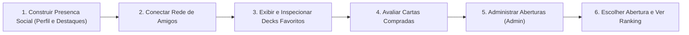

# Mapa da História do Usuário (User Story Map) — TCGHub

> [!NOTE]
> Artefato de **DDD Preliminar (Etapa 1 — Planejar, Onda 2)** cobrindo integralmente as **4 funcionalidades de Lucas Menezes** (`Perfil e amigos`, `Decks favoritos`, `Avaliação de cartas` e `Abertura preferida do anime One Piece`, incluindo a gestão administrativa em `adm`), em conformidade com [.agents.md](../../.agents.md) e [tcghub/AGENTS.md](../../tcghub/AGENTS.md).

---

## 1. Visão Geral e Princípios do Mapa

Todas as funcionalidades mapeadas entregam ciclos completos de **escrita (criação, edição, ativação/inativação, remoção), validação de invariantes de domínio e leitura/consulta**, vedando entregas exclusivamente de leitura:

- **Escopo**:
  1. `comunidade / F001`: **Perfil comunitário e rede de amigos** (`PerfilComunitario`, `Amizade`, `PerfilComunitarioVisibilidadeProxy`)
  2. `comunidade / F002`: **Decks favoritos** (`DeckFavorito`, `CatalogoDeckProxy`)
  3. `comunidade / F003`: **Avaliação de cartas** (`AvaliacaoProduto`, projeção `CompraVerificada`, `AvaliacaoElegibilidadeProxy`)
  4. `adm / F001` + `comunidade / F004`: **Abertura preferida do anime One Piece** (`Abertura`, `AberturaPreferida`, `AberturaPreferidaPrivacidadeProxy`)
- **Glossário base**: [docs/linguagem-onipresente/README.md](../linguagem-onipresente/README.md).
- **Funcionalidades pendentes de incorporação futura**: [docs/thiago-pendente/README.md](../thiago-pendente/README.md) (4 funcionalidades de Thiago Medeiros).

---

## 2. Backbone e Fluxo de Atividades

| Coluna do Backbone | Atividade do Usuário / Administrador | Subdomínio / Funcionalidade | Operações de Escrita & Validação | Operações de Leitura & Privacidade |
| :--- | :--- | :--- | :--- | :--- |
| **A1** | Construir presença social, editar dados e gerenciar destaques de cartas | `comunidade / F001` | Editar perfil, validar apelido único (*case-insensitive*), fixar/remover até 4 cartas | Visualizar próprio perfil, visualizar perfil público via Proxy |
| **A2** | Buscar colecionadores e administrar conexões bilaterais | `comunidade / F001` | Enviar solicitação, aceitar, recusar, cancelar, remover bilateralmente | Buscar colecionadores, listar amigos e solicitações pendentes/enviadas |
| **A3** | Selecionar até 4 decks favoritos e explorar composição | `comunidade / F002` | Adicionar deck ativo (máx. 4, sem duplicata), remover deck, ocultar/reexibir | Pesquisar decks ativos, expandir composição (líder, cartas, preços via SPI) |
| **A4** | Registrar e atualizar avaliações confiáveis de cartas | `comunidade / F003` | Avaliar (nota 1–5 + comentário), reavaliar, invalidar após reembolso | Consultar média, distribuição 5★–1★, selo *Compra Verificada* |
| **A5** | Manter base canônica de aberturas de One Piece | `adm / F001` | Cadastrar abertura (nº único), editar, inativar/reativar, excluir se sem uso | Pesquisar/filtrar por status (`Todas`, `Ativas`, `Inativas`), prévia de imagem |
| **A6** | Escolher abertura preferida e acompanhar comunidade/amigos | `comunidade / F004` | Escolher/substituir abertura ativa (1 por usuário), ocultar/reexibir no perfil | Listar ativas com contagem de amigos, ranking Top 5, detalhes e correspondência |

---

## 3. Mapa Detalhado por Funcionalidade e Fatia de Entrega

### 3.1 `comunidade / F001` — Perfil Comunitário e Rede de Amigos

| Atividade | Fatia 1 — Núcleo Funcional (Escrita + Leitura) | Fatia 2 — Vitrine Social e Validações | Fatia 3 — Privacidade e Proxy |
| :--- | :--- | :--- | :--- |
| **Perfil Comunitário** | **US-01**: Como usuário, quero consultar meu próprio perfil comunitário (`/comunidade/perfil-comunitario/visualizacao`) para visualizar apelido, cidade, descrição, foto, destaques e métricas. **US-02**: Como usuário, quero editar meu perfil (`/comunidade/perfil-comunitario/:id/alteracao`) atualizando foto, apelido, cidade, descrição e preferências públicas, ou cancelar preservando os dados anteriores. | **US-03**: Como usuário, quero que o sistema rejeite apelidos vazios ou já usados por outro usuário (inclusive variando maiúsculas/minúsculas, ex.: `ZoroTC` vs. `zorotc`). **US-04**: Como usuário, quero gerenciar meus **4 destaques de cartas favoritas** fixando cartas da minha coleção e removendo destaques para liberar espaço (sem duplicatas e com atalho `Ver no Catálogo`). | **US-05**: Como visitante, quero consultar o perfil público de outro colecionador (`/comunidade/perfil-comunitario/:id/visualizacao`) mediado pelo `PerfilComunitarioVisibilidadeProxy`. **US-06**: Como usuário, quero alternar preferências de visibilidade (ex.: *Wishlist pública com token seguro* e *Exibir Decks Favoritos no perfil*) e impedir edições não autorizadas em perfis alheios. |
| **Rede de Amigos** | **US-07**: Como usuário, quero buscar colecionadores (`/comunidade/amizade/pesquisa`) e enviar solicitação de amizade (`/comunidade/amizade/inclusao`), ficando com status `PENDENTE`. **US-08**: Como destinatário, quero aceitar uma solicitação pendente para estabelecer amizade bilateral entre os dois perfis. | **US-09**: Como destinatário, quero recusar uma solicitação recebida sem criar vínculo. **US-10**: Como solicitante, quero cancelar uma solicitação pendente enviada. **US-11**: Como usuário, quero impedir autoamizade, solicitações duplicadas ou solicitações para usuários inexistentes/já amigos. | **US-12**: Como usuário, quero remover um amigo e apagar a relação bilateralmente dos dois lados. **US-13**: Como sistema, quero bloquear aceitação ou cancelamento por usuários que não sejam parte autorizada da solicitação. |

### 3.2 `comunidade / F002` — Decks Favoritos

| Atividade | Fatia 1 — Gestão dos Favoritos (Escrita + Leitura) | Fatia 2 — Integração via Proxy com Catálogo | Fatia 3 — Privacidade e Preservação |
| :--- | :--- | :--- | :--- |
| **Lista e Inclusão de Decks** | **US-14**: Como usuário, quero pesquisar decks ativos disponíveis e adicionar até **4 decks favoritos** ao meu perfil (`/comunidade/deck-favorito/inclusao`). **US-15**: Como usuário, quero remover um deck favorito (`/comunidade/deck-favorito/:id/exclusao`) para liberar vaga para outro deck. | **US-16**: Como sistema, quero validar via `CatalogoDeckProxy` que o deck existe, está `ATIVO` e não está duplicado na lista do usuário, rejeitando o 5º deck. **US-17**: Como usuário, quero expandir a composição de um deck favorito (`/comunidade/deck-favorito/:id/visualizacao`) vendo líder, personagens/eventos/estágios, quantidades, preços unitários, custo estimado, botão `Ver no Catálogo` e ação `Copiar Decklist`. | **US-18**: Como usuário, quero **ocultar ou reexibir** meus decks favoritos no perfil público sem perder minha lista salva. **US-19**: Como usuário, quero manter um deck já favoritado mesmo se ele se tornar `INATIVO` no Catálogo (bloqueando apenas novas escolhas) e receber tratamento amigável caso a SPI do Catálogo esteja indisponível. |

### 3.3 `comunidade / F003` — Avaliação de Cartas

| Atividade | Fatia 1 — Avaliar e Reavaliar | Fatia 2 — Elegibilidade e Selo de Confiança | Fatia 3 — Média Comunitária e Reembolso |
| :--- | :--- | :--- | :--- |
| **Avaliação por Compradores** | **US-20**: Como comprador, quero acessar `Avaliar` na minha coleção ou `Avaliar Carta` na página do produto (`/comunidade/avaliacao-produto/inclusao`) e registrar nota de **1 a 5** e comentário opcional. **US-21**: Como comprador, quero editar minha avaliação existente (`/comunidade/avaliacao-produto/:id/alteracao`) atualizando nota ou comentário (ou cancelar preservando o estado anterior) sem duplicar minha contagem. | **US-22**: Como sistema, quero validar via `AvaliacaoElegibilidadeProxy` e projeção `CompraVerificada` que apenas usuários com ao menos um **pedido pago e não reembolsado** daquela carta podem avaliá-la. **US-23**: Como visitante, quero visualizar o selo **"Compra Verificada"** em todas as avaliações válidas exibidas na comunidade. | **US-24**: Como visitante, quero consultar no Catálogo (`/comunidade/avaliacao-produto/pesquisa`) a média aritmética (ou `0.0`), a quantidade de avaliações válidas e a distribuição `5★–1★`. **US-25**: Como sistema, quero invalidar automaticamente a avaliação e recalcular a média quando o único pedido válido for reembolsado (mantendo-a válida se houver outra compra elegível). |

### 3.4 `adm / F001` e `comunidade / F004` — Abertura Preferida do Anime One Piece

| Atividade | Fatia 1 — Base Administrativa (`adm`) | Fatia 2 — Escolha e Ranking (`comunidade`) | Fatia 3 — Privacidade e Correspondência Social |
| :--- | :--- | :--- | :--- |
| **Gestão Admin (`adm / F001`)** | **US-26**: Como administrador, quero cadastrar aberturas (`número`, `nome`, `artista`, `episódios`, `imagem`, `vídeo`, `status`) em `/adm/abertura/inclusao` com prévia da imagem e validação de número único. **US-27**: Como administrador, quero pesquisar e filtrar aberturas por status (`Todas`, `Ativas`, `Inativas`) em `/adm/abertura/pesquisa` e editar dados em `/adm/abertura/:id/alteracao`. | **US-28**: Como administrador, quero **inativar e reativar** aberturas sem apagar escolhas já feitas por usuários. **US-29**: Como administrador, quero excluir fisicamente (`/adm/abertura/:id/exclusao`) uma abertura apenas quando nunca tiver sido escolhida por nenhum usuário, rejeitando a exclusão caso já possua vínculos. | **US-30**: Como sistema, quero exigir autorização `ADMINISTRADOR` para qualquer operação de escrita administrativa em aberturas. |
| **Escolha e Ranking (`comunidade / F004`)** | **US-31**: Como usuário, quero listar e pesquisar apenas aberturas **ativas** por nome, número ou artista em `/comunidade/abertura-preferida/pesquisa` e definir ou substituir minha única abertura preferida. **US-32**: Como usuário, quero visualizar o **Ranking Top 5 da Comunidade** com posição, quantidade de votos, total geral e percentual proporcional. | **US-33**: Como usuário, quero consultar os detalhes de uma abertura (`/comunidade/abertura-preferida/:id/visualizacao`) com artista, episódios, posição no ranking, reprodução de vídeo e quantidade/lista de amigos que também a escolheram. **US-34**: Como usuário que possuía uma abertura posteriormente inativada, quero manter minha escolha atual até substituí-la por outra abertura ativa. | **US-35**: Como usuário, quero **ocultar ou reexibir** minha abertura preferida no perfil público via `AberturaPreferidaPrivacidadeProxy` sem perder minha escolha nem deixar de somar anonimamente no ranking Top 5. **US-36**: Como amigo visitante, quero ver no perfil de um amigo quando compartilhamos a mesma abertura preferida pública, sem jamais expor a escolha quando ele a manteve oculta. |

---

## 4. Resumo de Cobertura Escrita vs. Leitura (Sem Funcionalidades Read-Only)

| Funcionalidade | Operações de Escrita / Mutação | Operações de Leitura / Consulta |
| :--- | :--- | :--- |
| `comunidade / F001` (Perfil e amigos) | Editar perfil; fixar/remover carta destaque; enviar, aceitar, recusar, cancelar e remover amizade bilateralmente | Consultar próprio perfil; consultar perfil público (Proxy); buscar colecionadores; listar amigos e solicitações |
| `comunidade / F002` (Decks favoritos) | Adicionar deck favorito; remover deck favorito; ocultar/reexibir lista no perfil público | Pesquisar decks ativos; listar favoritos; expandir composição detalhada via `CatalogoDeckProxy` |
| `comunidade / F003` (Avaliação de cartas) | Registrar avaliação (1–5 + comentário); atualizar avaliação; invalidar por reembolso | Consultar resumo (média, total, histograma) e lista de avaliações com selo *Compra Verificada* |
| `adm / F001` (Abertura admin) | Cadastrar abertura; editar abertura; inativar; reativar; excluir abertura sem escolhas | Pesquisar e filtrar aberturas por status e termo; consultar detalhes e contagem de preferências |
| `comunidade / F004` (Abertura preferida) | Escolher abertura ativa; substituir preferência; ocultar/reexibir visibilidade pública | Listar aberturas ativas com filtros e contagem de amigos; consultar ranking Top 5; consultar detalhes e correspondência entre amigos |

---

## 5. Evolução Futura (Fora do Escopo da Onda 2)

As 4 funcionalidades de **Thiago Medeiros** (`Gestão do catálogo`, `Gestão de pedidos`, `Dashboard de vendas` e `Avise-me`) permanecem registradas em [docs/thiago-pendente/README.md](../thiago-pendente/README.md) e serão adicionadas como novas colunas do backbone após entrega formal de seus requisitos e confirmação explícita do usuário.
